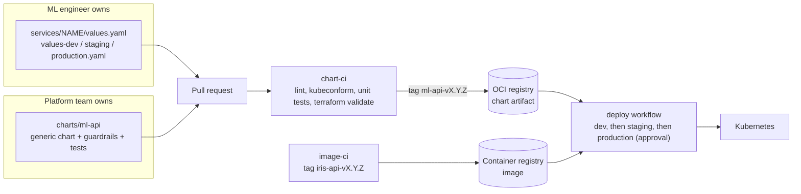
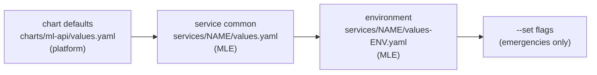
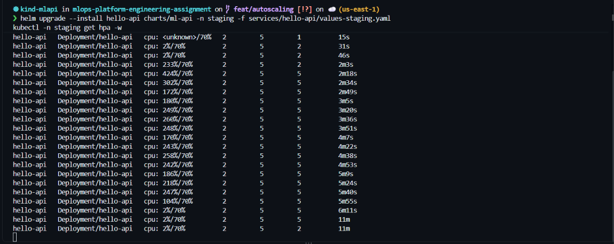
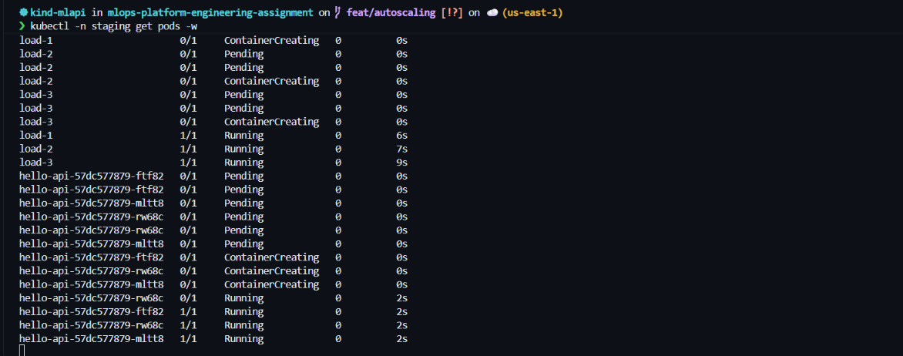
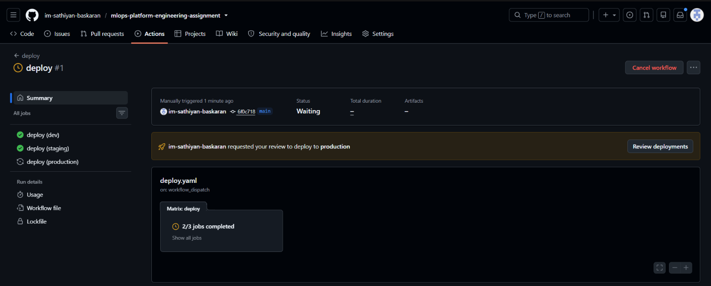
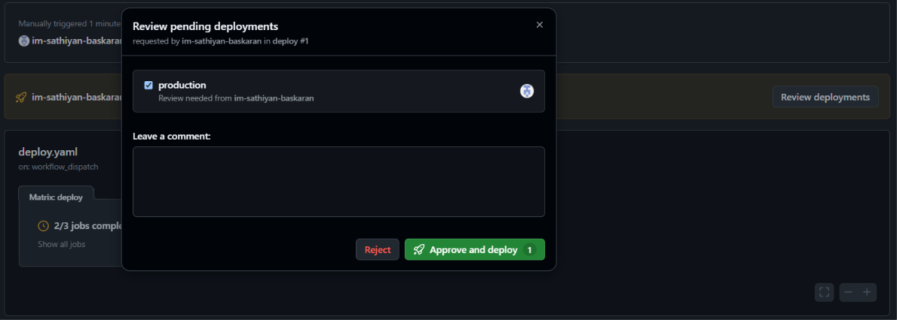
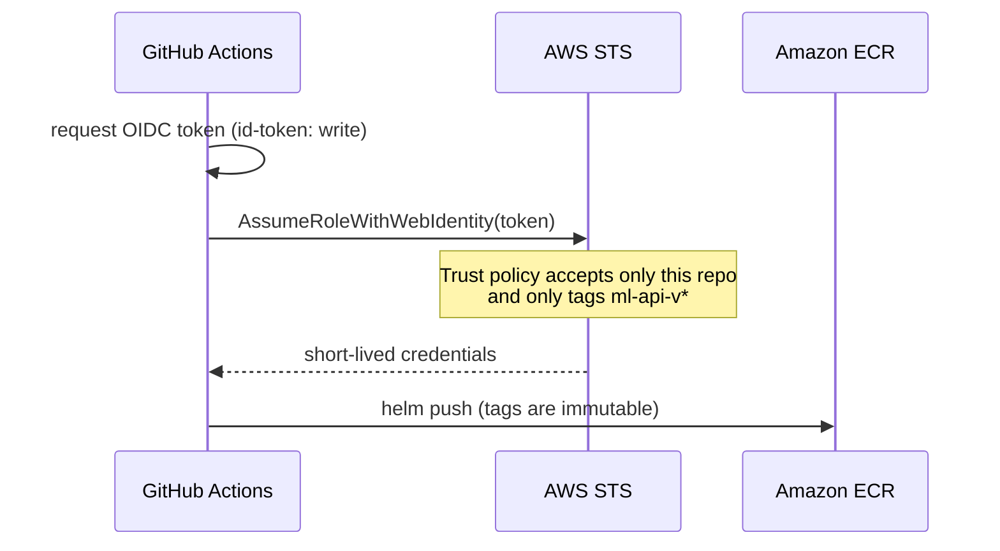
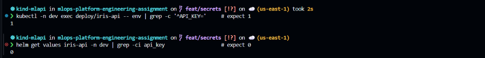
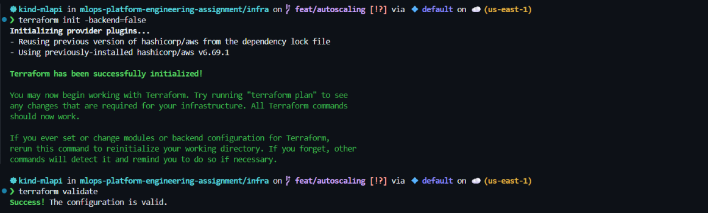

# ml-api — one generic Helm chart for every ML inference API

> A generic, opinionated Helm chart and delivery pipeline for deploying ML inference APIs to Kubernetes.
> An ML engineer (MLE) deploys a model API to **dev, staging and production** by writing
> about **10 lines of YAML per environment**. The platform owns everything else.

## TL;DR

| Capability | Where it is | Status |
|---|---|---|
| Generic Helm chart, 3 environments | [`charts/ml-api`](charts/ml-api), [`services/`](services) | Built, tested, deployed on kind |
| Deployable locally with **autoscaling** | [HPA template](charts/ml-api/templates/hpa.yaml), staging/production values | Built; scale-up and scale-down observed ([evidence](#autoscaling)) |
| ML API callable from my PC | [`apps/iris-api`](apps/iris-api) via NodePort `localhost:30080` | Built and called ([quickstart](#quickstart-5-minutes-on-kind)) |
| Chart test cases | [`charts/ml-api/tests`](charts/ml-api/tests) — 19 unit tests, lint, kubeconform | Built, run in CI |
| CI/CD that builds and publishes the chart | [`.github/workflows`](.github/workflows) | Built; chart and image published to GHCR |
| Secret handling | [`existingSecret` / External Secrets](#secrets) | Built and demonstrated; External Secrets rendered and tested only |
| IaC snippet | [`infra/`](infra) (registry + keyless CI role) and [`infra/deploy`](infra/deploy) (`helm_release`) | Written; `terraform validate` clean for `infra/` |
| Version-control strategy | [Versioning](#versioning-and-release-strategy) | Documented and enforced in CI |
| Extra: model-aware deployments | [Model version as a first-class value](#the-extra-model-aware-deployments) | Built and tested |

Anything that is not fully built is listed honestly in [Scope](#scope-built-vs-designed).

---

## The idea (how I think about it)

An ML platform is not "a Kubernetes template". What you deploy is a **model version**, and the people
deploying it are data scientists, not Kubernetes experts. Six principles shaped every choice:

1. **Golden path, not a toolbox.** One chart with safe defaults (non-root, read-only filesystem, probes, resource
   limits). An MLE who does nothing special gets a production-safe deployment.
2. **Values are the contract.** MLEs touch only `services/<name>/values*.yaml`. Everything else is platform code
   reviewed separately. Fewer knobs means fewer incidents.
3. **Build once, promote the same artifact.** The image and the chart are versioned, immutable and published once.
   Environments differ only in values, never in code.
4. **Guardrails fail early.** Misconfiguration breaks `helm lint`, `helm template` or a unit test in a pull
   request, not a pod in production.
5. **Git is the source of truth; secrets are names, not values.** The repo and Helm release record only the *name*
   of a Secret. Values live in a secret manager.
6. **Be honest about scope.** Prove a small thing end to end instead of claiming a large thing.



---

## Repository layout

```text
00-before/        the "before" picture: copy-pasted manifests per environment (why this exists)
apps/iris-api/    a real, small ML API (FastAPI + scikit-learn) used as the sample workload
charts/ml-api/    THE generic chart: templates, values.yaml, unit tests
services/         per-service values: what an MLE actually writes
  iris-api/         values.yaml (common) + values-dev / staging / production.yaml
  hello-api/        the minimal smoke-test service used while building the chart
infra/            Terraform: private registry + keyless CI role (infra/deploy: helm_release)
.github/workflows chart-ci, image-ci, deploy
```

## Quickstart (5 minutes, on kind)

Prerequisites: Docker, kind, kubectl, Helm 3.19.

```bash
# 1. Cluster (maps host port 30080 to the cluster so the API is callable from your PC)
kind create cluster --name mlapi --config 00-before/kind-config.yaml

# 2. Build the sample model API and load it into the cluster
docker build -t iris-api:0.1.0 apps/iris-api
kind load docker-image iris-api:0.1.0 --name mlapi

# 3. Deploy to dev: common values + environment overrides
helm upgrade --install iris-api charts/ml-api -n dev --create-namespace \
  -f services/iris-api/values.yaml -f services/iris-api/values-dev.yaml
kubectl -n dev rollout status deploy/iris-api

# 4. Call it from your PC
curl -s localhost:30080/predict -H 'content-type: application/json' \
  -d '{"sepal_length":6.7,"sepal_width":3.0,"petal_length":5.2,"petal_width":2.3}'
```

Result from my machine:

```json
{"model":"iris-classifier","version":"1","prediction":"virginica","confidence":0.9199}
```

Staging and production are `ClusterIP`; reach them with
`kubectl -n staging port-forward svc/iris-api 8081:80`.

## How an MLE deploys their own API

Create `services/<my-api>/` with a common file and one small file per environment.

`services/iris-api/values.yaml` — written once:

```yaml
image:
  repository: iris-api
  tag: "0.1.0"
containerPort: 8000
model:
  name: iris-classifier
  version: "1"
probes:
  liveness:
    path: /healthz
  readiness:
    path: /readyz
resources:
  requests: { cpu: 100m, memory: 200Mi }
  limits: { memory: 400Mi }
```

`values-dev.yaml` (each environment file is only a few lines):

```yaml
service:
  type: NodePort
  nodePort: 30080
```

`values-production.yaml`:

```yaml
autoscaling:
  enabled: true
  minReplicas: 3
  maxReplicas: 10
  targetCPUUtilizationPercentage: 65
```

That is the whole contract. Deployment, Service, HPA, probes, security context, labels, metrics wiring and secret
injection come from the chart.

### Values layering

Later files win. Maps merge key by key; lists are replaced.



Namespace is a **release property** (`-n dev`), not a values key. A namespace created by the chart would be deleted
on `helm uninstall`, taking everything in it along.

---

## Autoscaling

`autoscaling.enabled: true` renders a `HorizontalPodAutoscaler` (autoscaling/v2). When it is on, the Deployment
omits `replicas`, so a later `helm upgrade` cannot reset the count and fight the autoscaler.

| Decision | Choice | Trade-off |
|---|---|---|
| Scaler | HPA (built in) | No extra operator. Scale-to-zero and queue-driven scaling need KEDA (see [Scope](#scope-built-vs-designed)). |
| Metric | CPU utilisation, memory optional | Simple and demonstrable. For real inference, latency or requests per second is a better signal. |
| Behaviour | Scale up immediately, scale down after 300 s | Absorbs bursty traffic without flapping, at the price of holding capacity a few minutes longer. |
| Misconfiguration | `fail` at render time if no metric is configured | Caught in CI, never on a cluster. |

**Observed on kind** (staging, three busy-loop load generators; `kubectl get hpa -w`):

| Time | CPU vs 70% target | Replicas |
|---|---|---|
| 0:31 | 2% | 2 |
| 2:03 | 233% | 2 |
| 2:18 | 424% | **5** (scaled out to the maximum) |
| 6:11 | 2% (load stopped) | 5 |
| ~11:00 | 2% | **2** (after the 300 s scale-down window) |



*`kubectl get hpa -w` for the staging release (the `hello-api` smoke-test workload): CPU climbs to 424% of the
target, replicas go 2 to 5, and after the load stops they return to 2 about five minutes later.*



*The three load generators start, then three new `hello-api` pods go Pending, ContainerCreating, Running as the HPA
scales out.*

Requires `metrics-server`. On kind it needs `--kubelet-insecure-tls` (self-signed kubelet certificates; never in
production):

```bash
kubectl apply -f https://github.com/kubernetes-sigs/metrics-server/releases/latest/download/components.yaml
kubectl -n kube-system patch deploy metrics-server --type=json \
  -p='[{"op":"add","path":"/spec/template/spec/containers/0/args/-","value":"--kubelet-insecure-tls"}]'
```

---

## Testing

| Layer | Tool | What it catches | Where it runs |
|---|---|---|---|
| Static | `helm lint --strict` | Broken templates, bad chart metadata | CI and local |
| Schema | `kubeconform -strict` on every environment | Invalid Kubernetes objects after rendering | CI and local |
| Behaviour | `helm-unittest` — 19 tests, 5 suites | Logic bugs (see below) | CI and local |
| Live | kind cluster + `curl` | "Does it actually answer?" | Local (documented in quickstart) |

```bash
helm plugin install https://github.com/helm-unittest/helm-unittest.git
helm unittest charts/ml-api
for env in dev staging production; do
  helm template iris-api charts/ml-api -n $env \
    -f services/iris-api/values.yaml -f services/iris-api/values-$env.yaml | kubeconform -strict -summary
done
```

A real bug these tests now guard against: while adding probes I nested new template fields inside a `with`
block, which changed their scope and made rendering fail with `can't evaluate field Values in type []interface {}`.
There is now a test that the probes and the security context still render when `args` is empty.

---

## CI/CD

Three small workflows, each with one clear purpose.

| Workflow | Trigger | What it does |
|---|---|---|
| [`chart-ci`](.github/workflows/chart-ci.yaml) | pull request, push to `main`, tag `ml-api-v*` | lint, unit tests, kubeconform for all environments, `terraform fmt/validate`; **on tag**: verify tag equals `Chart.yaml` version, package, push to the OCI registry |
| [`image-ci`](.github/workflows/image-ci.yaml) | tag `iris-api-v*` | build the image, push `ghcr.io/<owner>/iris-api:<version>` (immutable) |
| [`deploy`](.github/workflows/deploy.yaml) | manual (`workflow_dispatch`) | lint and render the plan for dev, then staging, then production; production waits for a required reviewer |



*The `deploy` workflow: `dev` and `staging` completed, `production` is paused waiting for a required reviewer.*



*The approval prompt for the `production` environment.*

Design choices:

- **Tag-driven releases.** Merging never publishes; only a tag does. The workflow fails if the tag and the chart
  version disagree, so a version cannot be silently overwritten or mislabelled.
- **Least privilege.** Default permission is `contents: read`; only the publish job gets `packages: write`.
- **No stored credentials.** GHCR login uses the per-run `GITHUB_TOKEN`. The AWS path uses OIDC (below), so there are no
  long-lived keys to leak or rotate.
- **Environment gates.** Each environment is a GitHub Environment; production requires a human approval.
- **Honest limit.** CI has no cluster, so `deploy` produces and validates the plan and shows exactly where the
  real `helm upgrade --install --atomic` goes (commented in the workflow). It does not apply anything.

### Keyless publishing to AWS (designed; infrastructure written and validated)



## Secrets

The rule: **the repo, the values files and the Helm release record contain secret names, never values.**

| Option | How | Trade-off |
|---|---|---|
| `secrets.existingSecret` | The chart reads a Secret that already exists in the namespace (`envFrom`) | Simplest; something else must create the Secret |
| External Secrets Operator | `secrets.external.enabled` renders an `ExternalSecret` that syncs from AWS Secrets Manager | Production path with rotation; needs the operator and IAM in the cluster |

Demonstrated on kind with `existingSecret`:

```bash
kubectl -n dev create secret generic iris-api-secrets --from-literal=API_KEY=demo-not-a-real-key
helm upgrade --install iris-api charts/ml-api -n dev -f services/iris-api/values.yaml \
  -f services/iris-api/values-dev.yaml --set secrets.existingSecret=iris-api-secrets
kubectl -n dev exec deploy/iris-api -- env | grep -c '^API_KEY='   # 1  (the pod has it)
helm get values iris-api -n dev | grep -ci api_key                 # 0  (Helm's record does not)
```



The `ExternalSecret` template is unit-tested (renders, targets the right Secret, fails without a data source) but was
not run against a real operator.

## Infrastructure as code

- [`infra/`](infra) — an ECR repository for the chart (immutable tags, scan on push, lifecycle policy) and the GitHub
  OIDC role with a trust policy scoped to this repository and `ml-api-v*` tags, plus a minimal push-only policy.
  `terraform validate` passes; CI re-checks formatting and validation on every pull request.
- [`infra/deploy`](infra/deploy) — a `helm_release` that deploys the chart to a cluster from the same values files
  MLEs maintain (Helm provider v3 syntax).



```bash
terraform -chdir=infra/deploy init
terraform -chdir=infra/deploy apply -var environment=dev        # uses the kind-mlapi kube context
```

In a larger organisation this would sit under Terragrunt, with one small stack per environment so that state and
inputs stay separate:

```hcl
# live/production/terragrunt.hcl
terraform { source = "${get_repo_root()}//infra/deploy" }
inputs = {
  environment      = "production"
  service          = "iris-api"
  chart_repository = "oci://<account>.dkr.ecr.<region>.amazonaws.com/charts"
  chart_version    = "0.3.0"
}
```

---

## The extra: model-aware deployments

`model.name` and `model.version` are first-class values. The chart turns them into:

- pod labels `ml-platform/model-name` and `ml-platform/model-version`,
- env vars `MODEL_NAME` and `MODEL_VERSION` for the API,
- Datadog Unified Service Tagging labels `tags.datadoghq.com/env|service|version` (version = model version, falling
  back to the image tag) and matching `DD_*` env vars.

So "which model version is serving in staging?" is one query, and a latency regression can be tied to a model
rollout in a dashboard. Verified on the cluster:

```text
ml-platform/model-name=iris-classifier
ml-platform/model-version=1
tags.datadoghq.com/env=dev
tags.datadoghq.com/service=iris-api
tags.datadoghq.com/version=1
```

This prepares the pods for a Datadog agent; it does not install one.

---

## Versioning and release strategy

| Artifact | Scheme | Rule |
|---|---|---|
| Chart | SemVer, git tag `ml-api-vX.Y.Z` | MAJOR = breaking change to the values contract; MINOR = new optional values; PATCH = fixes. CI refuses a tag that differs from `Chart.yaml`. |
| Image | SemVer, git tag `iris-api-vX.Y.Z` | Immutable. Never `latest`; the tag is what the values file pins. |
| Model | its own version in `model.version` | Image and model lifecycles are separate concepts (see [Scope](#scope-built-vs-designed)). |

Branching is trunk-based: short-lived branches, a pull request with CI checks for every change, and merges into
`main`. Releases are tags. Conventional commit messages (`feat:`, `fix:`, `ci:`, `chore:`) make the history readable and
allow changelog automation later. Rollback is `helm rollback` or redeploying the previous tag; because artifacts are
immutable, "previous" is always exactly what ran before.

## Design decisions and trade-offs

| Decision | Chosen | Alternative | Why |
|---|---|---|---|
| Chart registry | GHCR for the demo; ECR written in Terraform | ECR only | GHCR needs no cloud account and works with `GITHUB_TOKEN`; ECR is the production target for an AWS shop |
| Chart packaging | OCI artifact | classic repo with `index.yaml` | No index to host or keep consistent; same registry tooling as images |
| Model in image | Trained and baked into the image | Model loaded from a registry at start | Runs offline for the demo; production should decouple them |
| Autoscaler | HPA on CPU | KEDA, custom metrics | Zero extra components; upgrade path is documented |
| Secrets | names in Git, values in a manager | encrypted secrets in Git | Nothing sensitive in history at all |
| Repo shape | chart and services in one repo | separate repos | One place to review everything; in production MLEs would keep `services/<name>` in their own repo and consume the published chart |
| Deploy | atomic, plan-first | direct apply | A failed rollout rolls itself back |

## Scope: built vs designed

**Built and verified**
- Generic chart, three environments, real model API, called from my PC
- HPA, with observed scale-up and scale-down
- 19 unit tests, lint, kubeconform in CI; chart and image published to GHCR by tag
- Secret injection (`existingSecret`) demonstrated; model/Datadog tagging verified
- Terraform for registry and keyless CI role (`validate` clean)

**Designed, not built** (deliberately out of scope for a laptop-sized demo)
- Live AWS publishing job in CI (the Terraform exists; wiring it needs a real AWS account)
- External Secrets Operator running in a cluster (template and tests only)
- Datadog agent and OpenMetrics scraping of `/metrics`; dashboards and alerts
- MLflow: a model-loader init container that pulls `models:/name@alias` into a shared volume, so the image and the
  model can be versioned independently. An LLM-monitoring variant would add prompt and response sampling and cost
  metrics to the same metrics pipeline.
- KEDA for queue-driven and scale-to-zero workloads; image signing with cosign; `helm test` hook that makes a real
  prediction; a values JSON schema to reject typos

## Cleanup

```bash
kind delete cluster --name mlapi
```
